---
rascaltwo-ai-setup:
  kind: tool
  state: true
  deletion-policy: retain
  integrates:
    timeline-studio: reads the plan, writes comments, sessions, the Review (border) channel and its own line of the plan notice
    herdr: one tab per run, in a space per project, read through `herdr agent list`
    claude-code: interactive sessions with --dangerously-skip-permissions; Stop and SessionStart hooks; restarts use --resume
    launchd: [com.rascaltwo.kelpie.tick]
    ai-tidemark: reads its weekly usage records for the usage gate
  requires:
    commands: [bun, git, herdr, claude]
  platforms: macOS (launchd); the rest is portable
---

# kelpie

Hands tasks you've **signed off** (`refinedAt`) and **delegated** (For: Agent, in the
project's Project colour) to autonomous Claude Code agents, one herdr tab per task. Each agent works
in its own folder, hands its work back for review, takes your feedback, and ships the
task once you mark it Approved. Your part: refine the task, review it, approve it.

The design was settled in a grilling session and a steelman pass, then reshaped in use (the
lane per project became For: Agent; a console was built and retired for working from herdr,
see the git history). The reasons that still matter are under *Decided against* below.

## How a task moves

```mermaid
stateDiagram-v2
  [*] --> working: tick dispatches (signed off, For: Agent, gate open)
  working --> waiting: agent runs `review` (or it goes quiet at a prompt for stall_minutes)
  waiting --> working: you comment, type in the pane, or mark Changes requested
  waiting --> shipping: you mark Approved
  shipping --> [*]: agent productionalizes, runs `finish`; tick cleans up
```



**Which task goes next** follows the plan's own rule (Auto-order, ADR 0012): the earliest deadline (`due`) first, then your rank, then unranked. A calendar event marked `kelpie: <project>` arrives due at its end, so it goes first when its time comes, unless something is due sooner.

**Kelpie tidies its own queues**, in the tick, with no agent ([ADR](../../docs/adr/2026-11-14-tidy-kelpie-queues-by-skipping-not-closing.md)). Of a recurring calendar event's copies (`gcal-<event id>_<instant>`) only the next one can run; the older ones drop out of the queues and `status` (they stay in the plan). A task queued (signed off, or waiting to be refined) that nobody has touched for 14 days (no edit, sign-off or comment) is *stale*: Kelpie stops starting it and `status` lists it under *Still want this?* (`status --json`: `stale`) with three answers: `kelpie keep <task>`, `kelpie drop <task>` (closed like `close`, not deleted) and `kelpie later <task>` (not before 14 days from now). Setting For: Agent counts as keep, and calendar tasks are never stale.

**When nothing signed off is ready, the agent refines instead.** The best-ranked delegated
task that is held up only by a missing sign-off gets a *refine* run. It names the personas whose experience the task changes (none: it makes no spec page and hands back with `review --questions`: who it checked, why none changes, and a recommendation; you decide), reads the project, drafts a description (what and why, done when, how to verify,
scope), and asks its questions through the same Needs review loop. It never writes code,
never starts the task, and never signs it off. It ends by making the task's **promised demo** (the `demo-viz` skill: each persona's before and a clickable fake journey of the after) and its **spec page** (the `spec-viz` skill, with the demo on top): the human judges each persona and example there, and its gated Sign off button runs the sign-off. When you sign it off, the refine run is
closed and the task starts over as ordinary work. Only tasks you delegated are refined. [`refine.md`](refine.md) is its briefing.

**When there is nothing left to build or refine, the agent dredges for new work.** A project with no task to build, refine or answer gets a *dredge* run in a 💡 tab: it follows the `dredge` skill, looking back over the project's finished tasks, run transcripts, commits and your pushback since its last dredge, and brings you every improvement worth proposing (judged by `plus-ultra`, uncapped). It never writes code. You approve, reject or file each one; filed ones go For: Agent, so they come back through refine. A dredge has no task: a live pane working in `~/.agents/state/kelpie/dredge/<project>/` is the run, and its `.started` stamp limits it to once a day, and only after a commit lands on a repo's base since the last one. The skill keeps the ledger of what it proposed and what you rejected, so it never pitches a rejected idea again without new evidence. [`dredge.md`](dredge.md) is its briefing.

**The tracker is the truth.** Nothing is stored except `state.json`, a cache of stall
timers. A run's state is read every tick from three things:
- the task's status;
- its **Review** value (the plan's `border` channel);
- the `[dispatch] …` comments this tool writes.

Your comments are told apart from the tool's by their `by` author (`kelpie`),
never by their text.

**Models.** Refines run on Opus 5.5 (medium effort), the same as a default build: they write the spec page, and changing models part-way isn't worth it. A refine ends the task's description with
`Build with: opus` (Opus 5.5, medium: the default) or `Build with: sonnet` (Sonnet 5.5, high: mechanical,
well-specified work), and your sign-off approves it along with the rest of the description; the
build starts on that model. The table is `MODELS` in `dispatcher.ts`.

**Capacity.**
- Building and refining have separate capacity, so a refine run never holds up a build.
  Each project has one build slot and one refine slot. A run holds its slot from start until it is
  finished (a refine signed off, a build done), including while it waits on you.
- Only a few projects run at once: one when Kelpie is turned on (`resume`), and one more each time you run `kelpie more` (`kelpie less` for one fewer). The number lives in `~/.config/kelpie/active`; a missing file means 1. A project is active while it has any run in flight, waiting on you included, or a dredge open, and room goes to the highest-priority project that has work. `less` never stops a run: no new project starts until enough of the active ones finish. `less` goes down to 0: nothing starts on its own, not even in active projects, while Build now / Refine now (and the `-next` commands) still work; `resume` keeps a 0. `status` marks the active projects.
- Within that, projects don't share slots: with three active projects, three builds and three refines can run at
  once. The tick starts at most one new build and one new refine per pass (every 5 minutes), so
  projects start staggered while usage data catches up.
- A new task starts only while weekly usage is under the even-pace line:
  `used% ≤ elapsed% × ceiling`, from ai-tidemark's newest record. Stale data counts as a
  shut gate. Replayed against three weeks of tidemark history before it shipped, it stayed
  shut for the whole 98%-used week and was open 86–100% of the time in the ~45%-used weeks.
- Runs already in flight always continue: replies, shipping and restarts all go ahead.
- `priority: <number>` in a project file orders the projects, lowest first (unset ones go last, by file name). The top-priority project starts new builds and refines even while the gate is shut, so it gets the quota first; every other project still waits on the gate. Dredging always waits on it.

**Safety is guidance, by choice.** Agents run with `--dangerously-skip-permissions`, and
[`prompt.md`](prompt.md) tells them to touch nothing in production or on the internet
until you approve. Nothing enforces that rule.

## Pieces

| File | Does |
|---|---|
| `dispatcher.ts` | All the logic: config, derived state, the usage gate, task folders, the tick and the agent commands. |
| `timeline-studio.ts` | The `Tracker` for Timeline Studio, the only code that knows its API. |
| `herdr.ts` | The `Herdr` side: spawning tabs, reading agent state, relaying prompts. |
| `panel.ts` | A run's bar in its pane's app-panel, through the host's session file; and the `status` Note built from it. |
| `kelpie.ts` | The CLI: `tick`, `status [--json]`, `pause [project]`, `resume [project]`, `refine-next`, `build-next`, `refine <task>` and `build <task>` for you, the board and launchd; `keep`, `drop` and `later <task>` for the stale ones; `eta <time> ["<stage>"]`, `review "<handover>"`, `input`, `comment`, `history`, `finish` and (refine runs only) `describe` for agents, plus `signoff`, `approve`, `close` and `park`, which an agent runs only on your explicit word in its pane and which quote what you said into the task. |
| `prompt.md` | The briefing a working agent gets, with the project file's body appended. |
| `refine.md` | The briefing a refine run gets. |
| `dredge.md` | The briefing a dredge run gets. |
| `actions.ts` | What you start by hand past the limits: `refine-next`, `build-next`, and one task by name (`refine`/`build <task>`), with the reason a task can't start. |
| `projects.ts` | Creating, editing, retiring and reordering project files (`kelpie project …`), each checked by `loadProjects` before it is written. |
| `status.ts`, `status-shape.ts` | What `status` shows, as data: the table and `status --json` both come from it. The shape file has no imports, so the board shares it. |
| `viz-pages/kelpie-board/` | The board (see *The board*). |
| `wiring.ts` | The real dependencies the CLI wires together. |

## Working from herdr

Each project's agents run in their own herdr space ("Timeline Studio"), created on first use
with a shell tab at the project's repo, so your own space holds only your terminals. Each agent
runs in a tab named for its task: ✎ for a refine run, ⚒ for a build. It hands over in its pane
(what it did, then what it needs from you), and `review` records those same words on the task. Answer
it by typing in its pane (it logs what you said) or by commenting on the task. Tell it to sign
off, approve, close or park the task and it does so itself, quoting your words into the task's history;
it never does any of these on its own judgment. A refine run you drop ("delete it") ends with `close`, never sign-off: Kelpie reads `refinedAt` as your sign-off, whoever set it, so a refined task gets built. Parking unrefines a task without dropping it: the run
ends, the slot frees, and it goes back to the refine queue (behind its dependencies). Its folder and
branch stay, so the next refine and build pick up the work so far. Signing off, closing, parking and finishing end the run, so the agent's pane
closes 10 seconds later. `kelpie.ts pause` stops new runs
starting (running agents, relays, restarts and clean-up carry on) until `resume`; `pause <project>` does the same for one project (a `~/.config/kelpie/paused-<project>` file), until `resume <project>`. When you're idle,
`kelpie.ts refine-next [project]` refines the best-ranked handed-over task nobody has refined yet,
past the limits. `kelpie.ts build-next [project]` starts the best-ranked signed-off build past the usage gate, but only in a project whose build slot is free, so two builds never touch the same code. `more` and `less` change how many projects may run at once (see Capacity). `status [project]` shows every project, or just the one named, and flags a shut gate on its first line and on each queue's first task.

Each run says how long it expects to take, so a working run can be told from a stuck one without asking. Once it has read the task, the agent runs `kelpie eta 20m` (again after acting on your reply, or when it knows it will be late): that posts a bar titled with the task id to its pane's app-panel, whose deadline the herdr sidebar draws as `⏳~20m` beside its tab, orange `⏳+6m` once late, and notes `[dispatch] eta 20m` on the task. `review` turns the bar to "Waiting on you" with no deadline, so the ⏳ goes; `finish`, `close`, `park` and `signoff` mark it done. These only touch a bar that is up, and outside herdr or without app-panel every command still runs, just without one. A working run's Note in `status` reads its pane's app-panel session file: the longest-running bar against its estimate, then the run's own ETA, as in `working · viz tests 51m (usually 3m) · ⏳+28m`.

## The board

`viz-pages/kelpie-board/` is one page with every project on it: a row per project, highest priority first, whose columns run the way a task moves (refine queue, refining, build queue, building, waiting on you). Everything that needs you sits in a **Needs you** section at the top (below). Open it at `http://127.0.0.1:5180/Desktop/Desktop/Code/ai-setup/tools/kelpie/viz-pages/kelpie-board/`, in a browser tab or app-panel's `show`.

Its buttons run the CLI itself through the page's `api.ts`, so the board and the terminal never differ: Build next, Refine next and Pause/Resume per project; More/Less and Pause all in the header; and, on any task, Build now or Refine now (`kelpie build|refine <task>`). Those start past the usage gate and the active limit, like the `-next` commands, but never past an unmet dependency or a busy build slot: the button is greyed with the reason. When a start would skip the gate or the active limit, it asks for a second click that names what it skips. Blocked tasks fold into a *Blocked (n)* badge that opens a map of what waits on what. *Outside Kelpie (n)* in the header lists the open tasks Kelpie never runs: orphaned (For Agent but in no project's colour), in a project but not For Agent, and everything else (meetings left out), paused ones last; it turns amber when anything is orphaned. An orphan gets a project dropdown (`kelpie assign <task> <project>`, which adds the colour and keeps the task's others) and a project task gets **→ Agent** (`kelpie for-agent <task>`). *Expand all* opens every "+n more". It reads `status --json` every 15 seconds and after every press.

**Projects** (in the header, or *Edit* on a row) opens every project file, live and retired, in a text editor. Save runs `kelpie project save`, which checks the file with the same loader the tick uses and that its colour is a Project colour in the plan, and refuses to write a file that fails, quoting why; *+ New project* starts from the template above. *Retire* renames the file to `.md.retired` (a second click confirms; *Restore* undoes it), and ↑ ↓ on a row swap its `priority` with its neighbour's. It warns when a project has a run in flight, since changing its repos can pull a folder out from under the agent. From a terminal: `kelpie project list | save <id> [--new] < file | retire <id> | restore <id> | move <id> up|down`.

**Needs you** lists everything waiting on you, across all projects, and sends no notification: clear it when you have the energy. It holds a run's review handover (a spec to review, a build to approve), its `--questions`, an idle or stalled run, and a "Still want this?" for each task untouched for 14 days. A card says what it is (a spec or build handover's first line, which the agent writes as the impact sentence; the task's label for the rest) and what Kelpie needs, with the handover collapsed and the spec or demo page one link away. Stale cards have Keep, Drop and Later (`kelpie keep|drop|later <task>`). A run's card has a text box, and its buttons stay greyed until you have written something, because they say it in your words: Sign off (three ways, below), Approve, Park it and Close it run `kelpie signoff|approve|park|close "<your words>"` from the run's folder, and Send answer, Send reply, Send changes and Request changes run `kelpie page "<your words>"` (the same path as *Send corrections* on a spec page). Nothing is sent until you press one. Runs waiting on you come first, oldest first, because each holds its project's slot; stale items follow, oldest first, since they block nothing. Only the first eight show until you open *+n more*; an empty list reads "Nothing needs you." Each spec or build card carries a risk label, **Merge Danger** ([ADR](../../docs/adr/2026-11-14-label-needs-you-cards-by-fixed-rules-over-the-agents-merge-danger.md)). Every handover has three lines after its impact sentence: `Door: one-way | two-way`, `Blast radius: small | wide — <who or what it touches>`, `Undo: <how to revert>`. Fixed rules in `needs.ts` turn them into 🟢 two-way and small, 🟡 two-way and wide, or 🔴 one-way. A build whose project deploys on approval is 🔴 whatever the agent wrote, and a missing or garbled block is 🟡 "no risk block", never 🟢. The card shows the label with the blast radius and undo, and a 🔴 card says it needs your full attention. On a 🟢 card Approve (and a spec's default *Sign off · when a slot frees*) works without typing and records "approved from the board (🟢 two-way, small)"; words you type win. 🟡 and 🔴 cards, and every other button, still need your words.

**Sign-off also says when the build starts.** `kelpie signoff "<words>"` is "yes, do this" and, as before, the build starts when a slot frees. `--now` starts it at once, past the gate and the active limit like `kelpie build <task>` (a busy build slot still makes it wait for the slot); `--hold` signs it off but Kelpie never starts it on its own: `kelpie status` and the board's build queue say "held — start when you say", and `kelpie build <task>` (the board's Build now) releases it. The choice is the first line of the sign-off comment (`[dispatch] signoff when=now|hold`), so there is no new storage; it ends at the next dispatch or park. A held task is skipped by `build-next` too, which picks for itself. The spec card on Needs you has a button for each, and the spec page's Sign off has a menu beside it. Signing off in Timeline Studio itself is still "when a slot frees".

*Open in Timeline Studio* opens the plan with that task selected: the link is the plan's own address (`page` and `token` from `~/.config/timeline-studio/config.json`) plus `&{"task":"<id>"}`, which Timeline Studio reads once and strikes from the address bar.

## Configure

`~/.config/kelpie/config.json` is optional. These are the defaults:

```json
{ "ceiling": 0.85, "stall_minutes": 15, "stale_minutes": 30 }
```

There is one file per project at `~/.config/kelpie/projects/<id>.md`. Rename
it away from `.md` to disable the project (`kelpie project retire <id>` renames it to `.md.retired`).

```md
---
color: timeline-studio          # optional: its Project colour id; defaults to the file name
space: Timeline Studio          # optional: the herdr space its agents run in; defaults to the id in Title Case
repos:                          # optional; each becomes a worktree on agent/<task-id>
  - path: ~/Desktop/Desktop/Code/timeline-studio
    base: private/trunk         # branched off and merged back into
    live: origin/main           # optional: the ref whose tree is what's deployed (see Publishing)
    publish: ./squash-to-main.sh  # optional, needs live: run in the repo after the approved merge
setup: ["bun install"]          # run once in each fresh worktree
checks: ["bun test"]            # the agent runs these before asking for review
productionalize: |              # what "ship it" means once you approve; empty = nothing to ship
  Merge agent/<task-id> into private/trunk.
---
Anything the agent should know about this project.
```

### Publishing

A repo with `live` gets a line in the plan's notice (the text pinned above the chart) while its `base` is ahead of the live site: `🚢 Timeline Studio: 3 commits on trunk aren't live yet`, several projects comma-separated on the one line, or `trunk differs from the live site` when no commit on `base` has the live tree. The count is the commits on `base` after the newest `base` commit whose tree equals `live`'s tree: `main` is a one-commit orphan snapshot (`squash-to-main.sh`), so `main..trunk` would count all of history. Every tick recomputes it from local refs (no fetch) and rewrites only its own line, the one starting 🚢, and only when that line changes; every other line (the calendar sync's `📅🔄 …`) is kept as is. Once nothing is ahead, the line is removed. `kelpie status` prints the same line.

A repo with `publish` also deploys on approval. The build prompt's "when approved" step adds, after the merge: run `publish` in the repo, then wait for the CI run on the pushed commit (`gh run list --commit <sha>`, `gh run watch --exit-status`); red, or a failed publish, is handed back with `review`, nothing reverted. Before approval the build's handover says which other commits go live with it (`kelpie unpublished`: the `base` commits the live site lacks, minus the task's own), since the publish ships all of `base`. `finish` refuses while `base`'s tree isn't `live`'s (`--nothing-to-ship` overrides). Nothing publishes before approval, from a refine run, or from the tick. Only Timeline Studio has these set.

## Install

Each step ends with a check. Don't move on until it passes.

1. **Plan setup**, once, in Timeline Studio:
   - Relabel the `border` channel to "Review".
   - Add the border values `Needs review`, `Changes requested` and `Approved`. The tool
     finds them by label.
   - Add a `For` (shapes) value labelled `Agent`. Delegating a task = For: Agent; the
     tick also sets `noQueue` on it, so it never waits behind your own queue.

   Check: the Review chips show in the legend.
2. **A project file**, as above. Check: `./kelpie.ts status` lists the project
   and shows the gate.
3. **The launchd job.** The plist is checked in with placeholder paths:
   ```sh
   p=tools/kelpie/launchd/com.rascaltwo.kelpie.tick.plist
   sed -e "s|/Users/YOUR-USER/.agents/ai-setup|$PWD|g" -e "s|/Users/YOUR-USER|$HOME|g" $p > ~/Library/LaunchAgents/$(basename $p)
   launchctl bootstrap gui/$(id -u) ~/Library/LaunchAgents/$(basename $p)
   ```
   Check: `~/.agents/state/kelpie/tick.log` gains no `tick failed` lines, and
   `launchctl list | grep kelpie` shows exit status 0.

## Tests

`bun test tools/kelpie` runs the tick and the agent commands against an
in-memory tracker and a fake herdr. Task folders are real worktrees of a throwaway git
repo.

## Decided against

- **A 5-hour usage gate.** Only the weekly even-pace line gates new runs, by your call
  during the grilling.
- **A `pushurl` guardrail** (or any enforced sandbox). Safety stays guidance: the briefing
  and your word, by choice.
- **Unlimited restarts.** A run that dies three times in one round is flagged for you
  instead; deaths across a reboot don't count.

## Known ceilings

- **Order is your rank, else the plan's rank suggestion.** Delegated tasks with neither
  go last, in plan order.
- **An agent working in circles isn't detected.** Only a pane that stops changing for
  `stall_minutes` is flagged. If herdr reports it `idle` or `blocked`, that is the agent waiting on you
  (a comment `[dispatch] idle: …`, Needs review), not a stall; only `unknown` is "stalled". A pane
  with a background shell, subagent or workflow running is never flagged: each agent's Stop hook
  (`kelpie bg`) records them in the run folder's `.background`.
- **A spec page's Send corrections and Sign off reach the agent at once.** The page's backend runs
  `kelpie page "…"` (your words, as a comment authored by you, relayed to the pane now) and, on
  sign-off, tells the pane its run is over before the tick closes it. Send corrections waits for Kelpie's answer and shows it ("Told the agent.") before it marks the send and closes the tab; if `kelpie page` fails, the tab stays open, nothing is marked sent, and the bar says why.
- **A build hands over a live demo, and its Accept approves.** Every build hands over a `demo-viz` page (per persona, before | after, the promise one toggle away), never a PR draft and code film; those come with a PR that productionalize opens, or when you ask for "the diff tour". A build that cannot be demoed, or whose demo shows no difference, says so and why instead of asking you to approve. A signed-off task whose `spec.json` has no `demo` (signed before this) is not built: the tick puts it back in the refine queue. The page shows what a yes does beside Accept. Accept + Send runs `kelpie approve "<your words>"` from the run folder (no agent pane in its environment), which approves the task with your words and tells the build pane to productionalize; the pane stays open, and if it was closed the approval stands and the tick restarts the run. Changes + Send goes through `kelpie page` like any correction.
- **Sign off never buries a comment.** A comment still being spoken when you press waits to land; any comment the agent hasn't been sent turns the press into *Send corrections*, so the agent folds it in and you sign off the next version. The signed `spec.json` survives the refine run's cleanup, and the build's prompt quotes your sign-off words, comments included.
- **Comments only reach an agent while its run waits on you.** While it works, type into
  the pane.
- **A run waiting on you whose pane died (a reboot, a closed tab) is revived** in a fresh pane that
  shows its handover again and waits. Not counted as a crash; it changes nothing until you reply.
- **A restarted or revived run resumes its own conversation** (`claude --resume`), so it keeps its full context instead of rebuilding it from `history` and `notes/`. Each agent's SessionStart hook (`kelpie session`) records its session in the run folder's `.session`, and a `/clear` (auto-handoff) records the new one. With no transcript, or one with no reply yet (just cleared), it starts afresh with the full briefing as before. Agents started before this change have no `.session` and start afresh.
- **The live count trusts this Mac's refs.** A publish made from another machine isn't seen until this Mac fetches `origin`: the 🚢 line overstates until then. A publish from here moves `origin/main` itself (`git push`).
- **The notice is one shared string, last write wins.** If the calendar sync rewrites its line in the same instant as Kelpie, one of the two writes can be lost until the next tick or sync.
- **A folder whose work isn't shipped is kept, never deleted.** That means uncommitted
  changes, or a branch not merged into `base`. It gets a `.kept` file and a comment on the
  task. Clean it up by hand.
